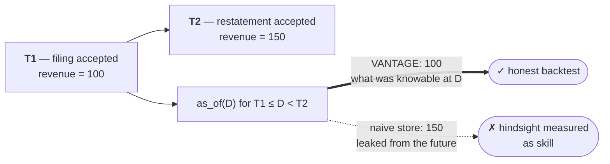
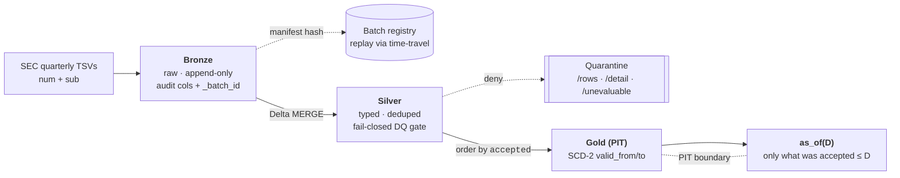

# VANTAGE — the viewpoint

**A point-in-time-correct financial-fundamentals lakehouse over the SEC Financial
Statement Data Sets** — built so that *"what did we know on date D?"* has exactly one
answer, and that answer never quietly changes.

[](https://github.com/hossainpazooki/pit-fundamentals-lakehouse/actions/workflows/ci.yml)


> **One of three terms.** **VANTAGE** fixes the viewpoint — where you stand when you
> read, as of date D. [**PARALLAX**](https://github.com/hossainpazooki/pit-revision-examiner)
> measures what shifts between viewpoints. **BASELINE** is the separation that makes two
> viewpoints comparable: known before the measurement, rigid during it. A shift becomes a
> measurement only across a baseline you can cite.
>
> → [**the baseline**](https://hossainpazooki.github.io/baseline)

One source tree, two build profiles: Scala 2.12 / classic Spark (local + the test
suite) and Scala 2.13 / Databricks Connect (serverless Databricks jobs).

## Why

Companies restate their filings. When they do, most datasets silently overwrite the
old value — and every backtest, model feature, or risk figure computed "as of" an
earlier date is now computed with information nobody had on that date. That is
**lookahead**: it inflates backtests, contaminates training data, and is invisible
after the fact because the corrupted answer *looks* plausible.



**The load-bearing property:** a query for *fundamentals as of date D* returns only
what was **filed and accepted on or before D** — no lookahead, including across
restatements. A later correction never leaks backward into an as-of-D answer.

**Who it's for:** anyone whose numbers must be defensible *as of a date* — quant
research and backtesting, ML feature stores over fundamentals, audit and
compliance reporting — and engineers who want a worked example of
verification-first data engineering.

The name is the property, not an acronym: a *vantage point* can't see past the
horizon of D.

## How

A three-layer medallion whose point-in-time boundary lives in Gold: validity
intervals ordered strictly by the SEC `accepted` timestamp, never ingest order.



Two guards hold the property up:

- **Content-addressed batch identity** — a batch id is a SHA-256 over source bytes
  + schema version + code SHA + params, registered so any historical table state is
  retrievable via Delta time-travel.
- **Fail-closed DQ gate** — a constraint that *cannot be evaluated* denies, same as
  one that is violated. Unevaluable never collapses into a pass; whole quarters are
  refused rather than silently repaired.

Scope is entity-level (consolidated) facts, within which the natural key is unique —
**measured, not assumed**, across every published FSDS quarter. The full enforcement
story, the properties-under-test table, and the stated limits:
[docs/SYSTEM.md](docs/SYSTEM.md).

Around that core the pipeline is orchestrated and served: an Airflow DAG expresses
the real shape (silver per quarter in sequence, gold rebuilt **once**, then audit,
with publish structurally unreachable when the audit is red or unevaluable), and a
dbt-duckdb layer over gold provides an as-of serving view and marts whose PIT
invariants are tested in CI. Both are exercised against a mutated twin, not only a
happy path.

## Proven, not promised

Nothing in this repo is credited on a self-reported success. Every claim is an
immutable record with its evidence linked — a real quarter reconciling against raw
file counts, the full 2009→present backfill with its refusals, a seam test shown able
to fail, and a Databricks publish verified as an *effect* rather than an exit code.

The claims and their evidence: [docs/STATUS.md](docs/STATUS.md).

## What the guarantee covers — and what it doesn't

The no-lookahead property is scoped to **the gold model**: `as_of(D)` returns only
what was accepted on or before D, across restatements. It is deliberately *not* an
end-to-end guarantee through the ingest seam, and this README does not claim one.

That boundary is why the sibling repo exists.
[PARALLAX](https://github.com/hossainpazooki/pit-revision-examiner) is an adversarial
consumer: it reads published gold through the as-of interface only, treats this repo
as unproven, and re-verifies the point-in-time invariants at read time with its own
gate — one that has to be shown red on a planted twin before any of its results
count. A producer's guarantee checked only by the producer is a guarantee on trust.

## Quick start

```bash
sbt test                  # the property suite (2.12 profile)
sbt assembly              # classic fat jar -> target/scala-2.12/
sbt "++2.13.16 assembly"  # serverless jar  -> target/scala-2.13/
```

Two-step run — `pit.Pipeline` per quarter through silver, then one
`pit.gold.GoldRebuild` pass. Config is the PIT_* contract, as env vars or as
`KEY=VALUE` program args (the serverless form). Commands, Windows setup, and the
Databricks bundle: [docs/DEVELOPMENT.md](docs/DEVELOPMENT.md).

## Docs

[docs/README.md](docs/README.md) is the index: what is authoritative
([SYSTEM](docs/SYSTEM.md) · [STATUS](docs/STATUS.md) — the dated state of record,
gates, runs and the claims table · [DEVELOPMENT](docs/DEVELOPMENT.md) ·
[adr/](docs/adr/README.md)) and what is a point-in-time record
([BACKFILL-METRICS](docs/BACKFILL-METRICS.md) ·
[GATE-B-WAP-EVIDENCE](docs/GATE-B-WAP-EVIDENCE.md) ·
[AIRFLOW-ORCHESTRATION-EVIDENCE](docs/AIRFLOW-ORCHESTRATION-EVIDENCE.md) ·
[DBT-EVIDENCE](docs/DBT-EVIDENCE.md)).

Claims everywhere in this repo are kept at or behind what the tests and the real
runs prove.
