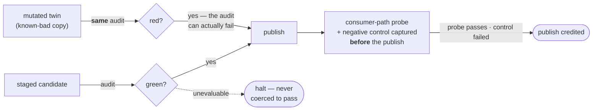

# Status — gates, runs, deployment

State as of 2026-07-19 (moved out of the README 2026-07-19). Live CI: see the
badge on the [README](../README.md) — GitHub Actions runs the full suite +
scalafmt/scalafix + fat-jar assembly on every push; that gate is the final word,
never an assumption. **40 tests pass.**

## Gates

| Gate / workstream | Scope | State | Evidence |
|---|---|---|---|
| **Build + property suite** | Bronze→silver→gold, both guards, PIT model; all transforms pure and unit-tested | **Green** — 40 tests, CI on every push | [SYSTEM.md](SYSTEM.md) properties table |
| **Gate A — real quarter** | 2026q1 end-to-end against raw-file counts | **Closed 2026-07-03** — reconciles exactly (details below) | local session records |
| **Seam test + full history** | Same-key restatement seam through the production path; 2009→present backfill | **Done 2026-07-08** — 2 real defects caught + fixed; 63/69 quarters ingested, 6 refused with recomputed causes | [BACKFILL-METRICS.md](BACKFILL-METRICS.md) |
| **Gate B — Databricks publish** | Serverless deploy + write-audit-publish verification of the 2026q1 publish | **Credited 2026-07-19** — three-part rule green end-to-end | [GATE-B-WAP-EVIDENCE.md](GATE-B-WAP-EVIDENCE.md) |
| **WS1 — local orchestration** | Airflow 3.0.2 over the real pipeline (mapped sequential silver, one gold rebuild, zero-retry audit, publish structurally unreachable on a red audit) | **Green 2026-07-22** — green leg 12/12 tasks; twin leg audit RED with `A1 == 10,217` exactly; unevaluable leg exit 2; publish `upstream_failed` on both red legs; backfill rerun idempotent | [AIRFLOW-ORCHESTRATION-EVIDENCE.md](AIRFLOW-ORCHESTRATION-EVIDENCE.md) · [ADR-0001](adr/0001-airflow-orchestration.md) |
| **WS2 — dbt serving layer** | dbt-duckdb over gold: as-of serving view + 2 marts, 3 PIT invariant tests, CI job on a pipeline-built fixture | **Green 2026-08-03** — `PASS=17` on `dev` and `ci`; `assert_as_of_key_unique` proven red on a mutated twin (planted 7 → `FAIL 7`). `full` target not yet run; the other 2 tests have no mutator | [DBT-EVIDENCE.md](DBT-EVIDENCE.md) · [ADR-0002](adr/0002-dbt-transform-layer.md) |

## Claims and their evidence

Moved out of the root README 2026-08-20 (README carries essentials only; evidence tables live here). Every row is an immutable record with its evidence linked — none of it is self-reported success.

| Claim | Evidence |
|---|---|
| A real quarter reconciles against raw-file counts **exactly** — 3,690,955 rows in, every row accounted for (scoped out / quarantined / landed in Gold), and Apple's 10-Q revenue byte-equal to raw `num.txt` | Gate A section below |
| Full 2009→present history: every published FSDS quarter processed; quarters carrying conflicting-value key collisions are **refused whole, fail-closed**, with causes recomputed from raw files | [BACKFILL-METRICS.md](BACKFILL-METRICS.md) |
| The restatement seam test can actually fail: a deliberately broken seam turns the suite red, and a committed negative control keeps the fixture's discriminating power pinned | Seam-test section below |
| The Databricks publish was verified as an **effect**, not an exit code — audit green on candidate *and* published tables, the same audit red on a corrupted twin to the exact planted count (429,949), consumer probe + pre-publish negative control | [GATE-B-WAP-EVIDENCE.md](GATE-B-WAP-EVIDENCE.md) |
| The same code publishes identically on independent compute: the serverless run reproduced the local run **row-for-row**, with identical source hashes in both registries | [GATE-B-WAP-EVIDENCE.md](GATE-B-WAP-EVIDENCE.md) |

The publish gate is a write-audit-publish shape where a publish is *credited* only
when all three legs hold — an audit that has never been seen red proves nothing:

## Gate A — validated against a real quarter (2026q1)

3,690,955 `num` rows, 6,169 filings. The run reconciles against raw-file counts
exactly: 2,185,031 rows scoped out (segment/coregistrant), 41,517 footnote-only rows
quarantined, 1,464,407 entity-level facts in Gold — with zero decimal-cast failures
and zero rows lost in the `sub` join. Spot-checked against the raw filing: Apple's
Q1 FY2026 10-Q (`0000320193-26-000006`, accepted 2026-01-30) reports revenue of
143,756,000,000 in Gold, byte-equal to the raw `num.txt` value. Before the
entity-level scope existed, the DQ gate correctly **fail-closed on this same
quarter** (66% natural-key collisions, 3.8% null values) — the refusal, its metrics
recomputed from the raw file, is what drove the scope decision.

## Seam test + full 2009→present history (2026-07-07/08)

The restatement seam test surfaced two real defects, both fixed the same session:
gold rebuilt per batch against only that batch's `sub` slice (silent history loss on
any multi-batch lake — caught by the test *before* the full-history backfill ran
through it), and `accepted`-tie ordering that fell to physical row order. The
negative control was run both ways: the committed non-vacuity test stays in the
suite, and an ephemeral `_ingest_ts`-ordered mutation of the production seam turned
the suite red before being reverted.

Every published FSDS quarter ingested — 63 of 69 into silver/gold (181,351,169
bronze rows; 86,615,392 gold facts across 16,667 CIKs), 6 refused by the DQ gate
with recomputed causes (2009q1 is published empty; five 2011–2012 quarters carry
natural-key collisions with conflicting values). Per-quarter metrics, all recomputed
from run artifacts and cross-checked against the run logs:
[BACKFILL-METRICS.md](BACKFILL-METRICS.md). Idempotency (rerun + diff) and one
registry time-travel reconstruction were re-executed, not asserted.

## Gate B — deployed and published on Databricks serverless (2026-07-19)

The target workspace allows only serverless compute, which forced the second build
profile: Scala 2.13 against Databricks Connect, the Deequ dependency replaced by the
native-aggregation DQ gate, and `io.delta.tables` calls replaced by their SQL
forms — all behind the same tests, which stayed 40/40 across the swap. The 2026q1
publish ran as the two-task bundle job and reproduced the local run **row-for-row**
(3,690,955 in / 2,185,031 scoped out / 41,517 quarantined / 1,464,407 gold facts,
gate Pass), with identical source hashes in both registries.

The publish was verified as an effect, not a report, under a three-part
write-audit-publish rule: the data audit green on the candidate **and** on the
published tables; the same audit demonstrably red on a deliberately corrupted twin
(429,949 lookahead rows planted at the as-of seam, caught to the exact count); and a
post-publish consumer-path probe that returned a value pre-derived from the local
lake, paired with a negative control captured against the workspace **before** the
publish. Full record with verbatim outputs:
[GATE-B-WAP-EVIDENCE.md](GATE-B-WAP-EVIDENCE.md).

Claims everywhere in this repo are kept at or behind what the tests and the real
runs prove.
